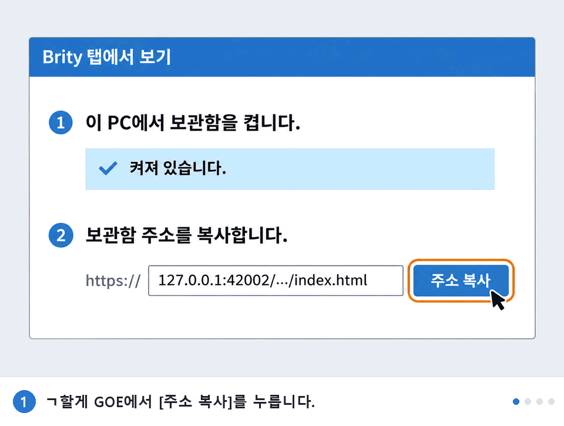

# ㄱ할게 GOE

GOE메신저의 대화와 쪽지를 메신저 없이 열어 보고, 엑셀(CSV)로 뽑는 프로그램입니다.
GOE메신저가 종료된 뒤에도 내 기록을 계속 보관하고 찾아볼 수 있고, Brity 메신저 안에 탭으로 넣어서 볼 수도 있습니다.
교실을 옮길 때는 기록과 받은 파일(첨부파일)을 USB에 담아 새 PC로 가져갑니다.
모든 처리가 내 PC 안에서만 이루어지고, 데이터는 PC 밖으로 나가지 않습니다.

made by [문수네집](https://moonsunezip.com) · [Instagram](https://www.instagram.com/moonsune.zip/)

> 이 저장소에는 **Brity 탭에서 보기**가 들어간 새 버전(1.4)을 올려 두었습니다.
> Brity 탭 기능은 실제 Brity 환경에서 확인하는 중입니다. 이전 버전(1.2)은 [goe-viewer](https://github.com/moonsugugu/goe-viewer)에 있습니다.

## 내려받기

| 파일 | 설명 |
|---|---|
| **[설치판 GoeViewerSetup.exe](https://github.com/moonsugugu/goe-viewer-brity/releases/latest/download/GoeViewerSetup.exe)** | 실행하면 설치되고 바탕 화면에 아이콘이 생깁니다. |
| [무설치판 GoeViewer.exe](https://github.com/moonsugugu/goe-viewer-brity/releases/latest/download/GoeViewer.exe) | 설치 없이 바로 실행합니다. |

위 링크를 누르면 바로 내려받습니다.

처음 실행할 때 "Windows의 PC 보호" 창이 뜨면 **추가 정보 → 실행**을 누르세요.
개인이 만든 프로그램이라 서명이 없어서 뜨는 창입니다.

## 이미 쓰고 있다면 (업데이트)

새 설치판을 받아 실행하면 같은 자리에 덮어써서 업데이트됩니다. 프로그램이 켜져 있으면 먼저 닫아 주세요.
기억된 이름과 추출해 둔 CSV는 그대로 남습니다. 무설치판은 새 파일로 바꿔 쓰면 됩니다.

지금 쓰는 버전은 프로그램 왼쪽 아래에 적혀 있습니다. 버전 표시가 없으면 1.2 이하입니다.

## 사용법

1. 선생님 이름을 입력하고 **처음 시작하기**를 누릅니다.
   이 PC의 GOE메신저 기록에서 그 이름이 들어간 대화와 쪽지를 찾아 보여 주고, `문서\백업_Exports`에 CSV로도 저장합니다.
2. 두 번째부터는 **추출 없이 시작하기**가 빠릅니다. 저장해 둔 CSV를 바로 엽니다.
3. 위쪽 파란 띠에서 수신함·발신함·대화함을 켜고 검색창에 낱말을 넣습니다.
   **상세검색**을 열면 기간·제목·발신인·수신인·파일명·내용으로 좁힐 수 있습니다.
4. 줄을 누르면 쪽지 전문이나 대화방이 열립니다. 첨부파일 이름을 누르면 PC에서 그 파일을 찾아 엽니다.
5. 별을 눌러 즐겨찾기에 넣거나, 줄 앞의 칸을 체크해 분류함에 담아 정리할 수 있습니다.

자세한 내용은 `사용법.txt`에 있습니다.

## Brity 메신저 안에서 보기

Brity 워크스페이스에 탭을 하나 만들어 두면, 이 프로그램을 켜지 않아도 Brity 안에서 기록을 봅니다.
먼저 **처음 시작하기**로 기록을 한 번 저장해 둔 뒤에 하세요.

1. **Brity 탭에서 보기**를 누르고 **켜기**를 누릅니다.
   처음 켤 때 Windows가 인증서를 설치할지 묻습니다. **예**를 누르세요. Brity가 이 PC의 기록을 열 때만 쓰는 인증서입니다.
2. **주소 복사**를 누릅니다.
3. Brity에 탭을 만듭니다.



순서를 보여 주는 그림입니다. 실제 Brity 화면과는 모양이 조금 다릅니다. 같은 그림이 프로그램 안에도 있습니다.

   1. Brity에서 나만 들어 있는 워크스페이스의 채널을 엽니다. 없으면 **새 워크스페이스 만들기**로 하나 만듭니다.
   2. 채널 위쪽의 `메시지 · 공지 · 파일 · 링크` 탭 줄 끝에 있는 **+** 를 누릅니다. 창이 좁으면 탭 줄의 펼침 목록 안에 '웹사이트 탭 추가'로 들어 있습니다.
   3. **웹사이트 탭 추가** 창의 '탭 이름'에 `ㄱ할게 GOE`라고 적습니다. 10자까지 됩니다.
   4. 'URL 주소' 칸의 `https://` 뒤를 누르고 Ctrl+V로 붙여넣습니다. 주소가 `index.html`로 끝나면 맞습니다.
   5. **추가**를 누릅니다. 탭 줄에 ㄱ할게 GOE가 생기고, 그 탭을 누르면 기록이 보입니다.

잘 안 될 때

- 빨간 글씨 '형식이 유효하지 않습니다.'가 뜨면 주소가 `index.html`로 끝나는지 봅니다. **주소 복사**를 다시 눌러 붙여넣으세요. `https://`가 두 번 들어가도 이렇게 나옵니다.
- 탭은 생겼는데 기록 대신 '아래의 경우 사이트가 정상적으로 열리지 않을 수 있습니다.'가 보이면 이 PC의 Brity 연결이 꺼져 있는 것입니다. 프로그램에서 '켜져 있습니다'인지 확인하고 Brity에서 **새로고침**을 누릅니다.
- 기록 위쪽의 '사이트가 정상적으로 열리지 않는 경우, 여기를 클릭하십시오.'는 Brity가 늘 보여 주는 안내입니다. 오른쪽 ×로 닫으면 됩니다.
- 주소를 고치거나 탭을 지우려면 ㄱ할게 GOE 탭을 마우스 오른쪽 단추로 눌러 **편집**이나 **삭제**를 고릅니다.

알아 둘 점

- 켜 두면 PC를 켤 때 Brity 연결이 창 없이 함께 시작됩니다.
- 탭에서는 보기, 검색, 첨부파일 열기만 됩니다. GOE메신저 기록이 더 쌓였으면 프로그램에서 **처음 시작하기**를 다시 누르세요.
- 주소는 그 PC에서만 열립니다. 그래도 여럿이 쓰는 워크스페이스에는 넣지 마세요.
- 그만 쓰려면 같은 창에서 **끄기**를 누릅니다. 자동 시작과 인증서를 지웁니다.

## 교실(PC)을 옮길 때

GOE메신저 기록은 지금 쓰는 PC에만 있습니다. 옮길 것은 **기록(쪽지·대화)** 과 **받은 파일(첨부파일)** 두 가지입니다.
두 번에 나눠서 합니다. 창에 나오는 순서대로 누르면 됩니다.

**① 예전 PC에서: USB에 담기**

1. 이동식 디스크(USB)를 꽂고 **교실 옮기기 전 USB에 저장!** 을 누릅니다.
2. 담을 곳(USB)을 고르고, 이름과 받은 파일 폴더(`문서\GOE메신저`)를 확인한 뒤 **USB에 담기**를 누릅니다.

USB에는 이렇게 들어갑니다.

```
ㄱ할게GOE_백업
 ├ 백업_이름_날짜             기록 (쪽지·대화 CSV)
 ├ 받은 파일                  첨부파일
 └ 새 교실에서 여는 방법.txt   안내문
```

**② 새 PC에서: USB에서 꺼내기**

1. 새 PC에 ㄱ할게 GOE를 설치하고, USB를 꽂은 뒤 **새 교실에서 USB 불러오기**를 누릅니다.
2. USB를 고르고 이름을 입력한 뒤 **기록 넣기**를 누릅니다. 기록이 `문서\백업_Exports`에 들어갑니다.
3. **받은 파일 넣기**를 누릅니다. 받은 파일이 `문서\GOE메신저`에 들어갑니다. 다른 곳에 두려면 **다른 폴더로 바꾸기**로 고릅니다.
4. **기록 열기**를 누릅니다. 이제 USB는 뽑아도 됩니다. 다음부터는 **추출 없이 시작하기**로 열립니다.

- 받은 파일은 폴더째 담습니다. 파일이 많으면 시간이 걸립니다.
- 같은 이름의 다른 파일이 이미 있으면 덮어쓰지 않습니다. 중단했다가 다시 누르면 이어서 합니다.
- 받은 파일을 넣어 두면 쪽지의 첨부파일 이름을 눌러서 엽니다. 나중에 다른 폴더로 옮겼다면 **받은 파일 폴더**에서 그 폴더를 다시 정합니다.

## 실행 요구사항

- Windows 10 / 11 (64비트)
- Microsoft Edge WebView2 런타임. Windows 11과 최신 Windows 10에는 보통 이미 깔려 있습니다.
  화면이 하얗게만 뜨면 "Microsoft Edge WebView2 Runtime"을 설치하세요.
- **처음 시작하기**는 그 PC에서 GOE메신저를 쓴 적이 있어야 됩니다.

## 개인정보

- 찾기, 복호화, 표시, 저장이 모두 내 PC 안에서만 이루어집니다.
- 조회수 집계 같은 외부 전송 기능이 없습니다. 인터넷에 연결하는 것은 **새 버전 확인**이나 제작자 링크를 직접 눌렀을 때 브라우저가 열리는 경우뿐입니다.
- 이름을 입력해야만 그 이름이 들어간 기록을 불러옵니다.
- **Brity 탭에서 보기**를 켜도 기록은 내 PC 안에서만 오갑니다. Brity 서버나 인터넷으로 보내지 않습니다.
- 추출한 CSV에는 쪽지 내용이 그대로 들어 있습니다. 필요 없어지면 **CSV 폴더 열기**에서 지우세요.
- USB에는 쪽지와 대화 내용, 받은 파일이 그대로 담깁니다. 잃어버리지 않게 보관하세요.
